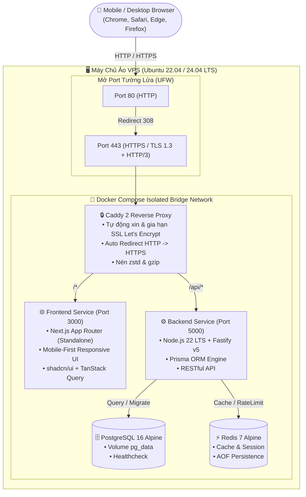

# 🚀 HƯỚNG DẪN TRIỂN KHAI DOCKER COMPOSE TRÊN VPS CÓ HTTPS

> **Fullstack Production Architecture Spec:**
> - **Backend:** Node.js 22 LTS, TypeScript, Fastify v5, Prisma ORM, PostgreSQL 16, Redis 7
> - **Frontend:** Next.js (App Router), TypeScript, TailwindCSS, shadcn/ui, TanStack Query
> - **Mạng & Bảo mật:** HTTPS Tự động (TLS 1.3 / HTTP/3), Let's Encrypt SSL, HSTS, HTTP -> HTTPS Redirect
> - **Trình duyệt mục tiêu:** Chrome, Safari (iOS/macOS), Edge, Firefox phiên bản mới nhất
> - **Thiết kế:** Mobile-First (Tối ưu trải nghiệm chạm & tốc độ tải trên mạng di động)

---

## 1. Sơ Đồ Kiến Trúc Hệ Thống Trên VPS



---

## 2. Các Bước Chuẩn Bị Trên VPS

### Bước 2.1: Cập nhật hệ thống & Cài đặt Docker
Đăng nhập SSH vào VPS:
```bash
ssh root@YOUR_VPS_IP
```

Cài đặt Docker Engine & Docker Compose Plugin mới nhất:
```bash
sudo apt update && sudo apt upgrade -y
sudo apt install -y curl git ufw ca-certificates gnupg

# Cài Docker chính thức
curl -fsSL https://get.docker.com -o get-docker.sh
sudo sh get-docker.sh

# Kích hoạt Docker service
sudo systemctl enable --now docker
```

### Bước 2.2: Cấu hình Tường Lửa (UFW Firewall)
Mở các cổng cần thiết cho web và SSH:
```bash
sudo ufw default deny incoming
sudo ufw default allow outgoing
sudo ufw allow 22/tcp    # SSH
sudo ufw allow 80/tcp    # HTTP (Let's Encrypt Verification)
sudo ufw allow 443/tcp   # HTTPS
sudo ufw allow 443/udp   # HTTP/3 (QUIC)
sudo ufw enable
```

### Bước 2.3: Trỏ Tên Miền (DNS A Record)
Vào trang quản lý tên miền (Cloudflare, Namecheap, GoDaddy, v.v.), tạo 2 bản ghi:
- **Loại A:** `@` ➔ `IP_CỦA_VPS`
- **Loại A:** `www` ➔ `IP_CỦA_VPS`
*(Lưu ý: Nếu dùng Cloudflare, hãy tắt proxy màu cam "DNS Only" trong lần đầu chạy để Let's Encrypt xác thực chứng chỉ).*

---

## 3. Khởi Chạy Dự Án Bằng Docker Compose

### Bước 3.1: Tải mã nguồn lên VPS
```bash
git clone https://github.com/RonahDev/Kietfolio.git /opt/app
cd /opt/app/infra/vps
```

### Bước 3.2: Thiết lập biến môi trường
Tạo file `.env` từ file mẫu:
```bash
cp .env.production.example .env
nano .env
```
Cập nhật các thông số thực tế:
```env
DOMAIN=yourdomain.com
ACME_EMAIL=your-email@gmail.com
DB_USER=kiet_postgres_user
DB_PASSWORD=TaoMatKhauDatabaseManh2026!
DB_NAME=kiet_production_db
REDIS_PASSWORD=TaoMatKhauRedisManh2026!
JWT_SECRET=TaoChuoiBiMatJWT64KyTuNgauNhien2026!
NODE_ENV=production
NEXT_PUBLIC_API_URL=https://yourdomain.com/api
```

### Bước 3.3: Build và Khởi động toàn bộ cụm dịch vụ
```bash
docker compose up -d --build
```

### Bước 3.4: Kiểm tra trạng thái hoạt động
```bash
# Kiểm tra tình trạng tất cả containers
docker compose ps

# Theo dõi logs trực tiếp của Caddy để thấy chứng chỉ SSL được cấp phát
docker compose logs -f reverse-proxy
```
Khi thấy dòng log:
`certificate obtained successfully` ➔ **Website của bạn đã có HTTPS xanh chuẩn A+!**

---

## 4. Tối Ưu Mobile-First & Tương Thích Trình Duyệt

### 4.1. Tối ưu hóa Giao diện Ưu Tiên Điện Thoại (Mobile-First)
Trong Next.js App Router (`layout.tsx` / `globals.css`):
1. **Viewport Meta Tag:**
   ```html
   <meta name="viewport" content="width=device-width, initial-scale=1, maximum-scale=5, viewport-fit=cover" />
   ```
2. **Touch Targets (Khoảng chạm ngón tay):** Tất cả nút bấm, link trên mobile có kích thước tối thiểu `44x44px` theo chuẩn Apple Human Interface Guidelines và Google Material Design.
3. **Safe Area Insets:** Hỗ trợ tai thỏ iPhone / viền cong Android:
   ```css
   padding-bottom: env(safe-area-inset-bottom);
   padding-top: env(safe-area-inset-top);
   ```

### 4.2. Khả Năng Tương Thích Trình Duyệt Hiện Đại
- **Chrome & Edge (Blink):** Hỗ trợ toàn diện HTTP/3, WebP/AVIF images.
- **Safari iOS & macOS (WebKit):** Khắc phục lỗi `100vh` bằng CSS `100dvh` (Dynamic Viewport Height).
- **Firefox (Gecko):** Tối ưu rendering flexbox & subgrid.

---

## 5. Các Lệnh Vận Hành & Bảo Trì Thường Dùng

| Tác vụ | Câu lệnh trên VPS |
| :--- | :--- |
| **Xem log realtime** | `docker compose logs -f [service_name]` |
| **Restart một dịch vụ** | `docker compose restart backend` |
| **Chạy migration DB** | `docker compose exec backend npx prisma migrate deploy` |
| **Backup PostgreSQL** | `docker compose exec -t db pg_dump -U kiet_postgres_user kiet_production_db > backup_$(date +%Y%m%d).sql` |
| **Cập nhật code mới** | `git pull && docker compose up -d --build` |
| **Dừng an toàn** | `docker compose down` |

